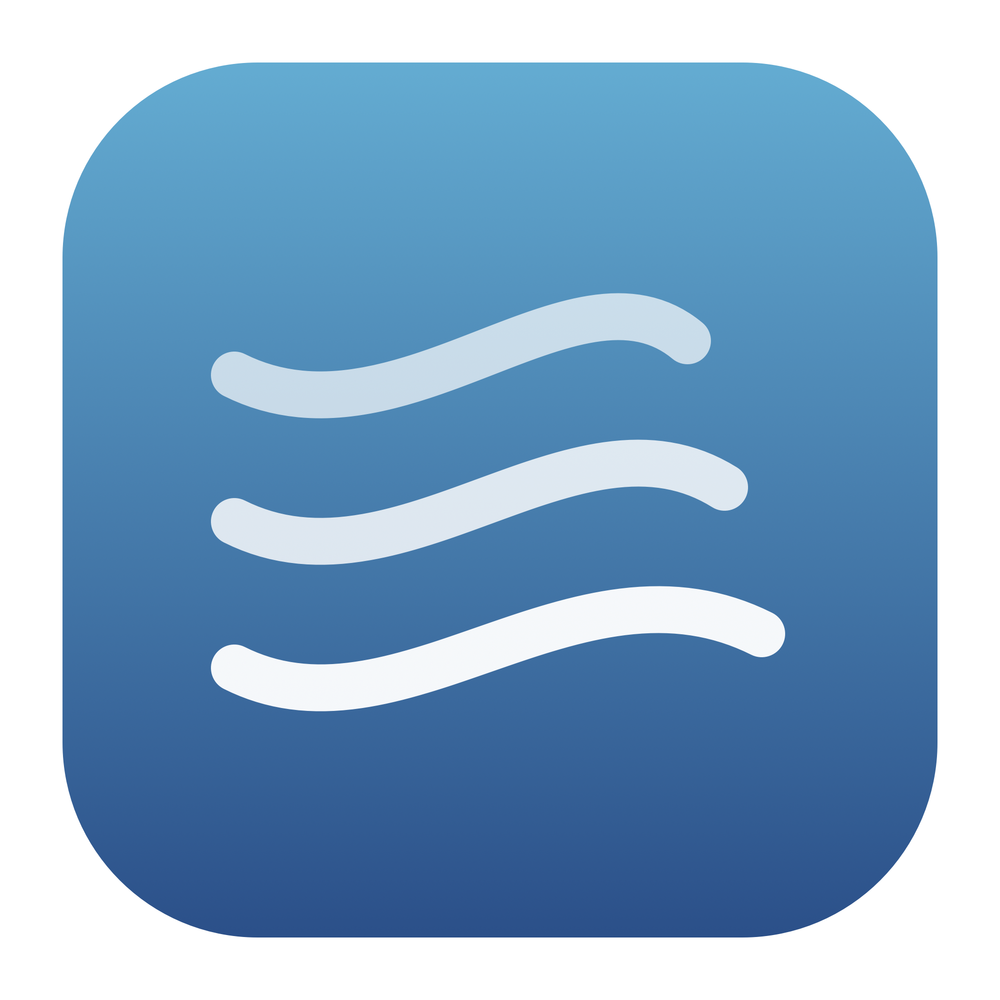

<div align="center">
  

<h1>Airloom</h1>

Your own videos, on your Mac’s desktop and lock screen.

<a href="https://github.com/sago-cream/Airloom/releases">Releases</a>
 · <a href="#install">Install with Homebrew</a>
</div>

## Why

- **Bring your own MP4.** Import a video through the native file picker. Airloom preserves its encoded video, removes audio, and leaves your original untouched.
- **One small menu.** Pause, import, enable the lock screen, start at login, and check for updates from the sparkle icon. No Dock window or preview panel.
- **Ready when you unlock.** The desktop player stays prepared through lock and sleep. Airloom aligns it with the native lock-screen renderer when timing is available.
- **Pause when it makes sense.** Playback pauses for covered desktops, sleeping displays, Low Power Mode, or your manual pause.
- **Native updates.** Signed and notarized universal builds, with Sparkle updates from GitHub Releases.

## Install

Install from the shared tap:

```bash
brew install --cask sago-cream/tap/airloom
```

Or download a signed and notarized ZIP from [GitHub Releases](https://github.com/sago-cream/Airloom/releases), extract **Airloom.app**, and move it to Applications.

Requirements:

- macOS 15 Sequoia or later, on Apple Silicon or Intel
- macOS 26 or later for native lock-screen animation
- Your own playable MP4; no wallpaper video is bundled

## First Run

1. Open Airloom from Applications. It appears in the menu bar.
2. Choose an MP4 when prompted, or use **Import Video…** from the sparkle menu.
3. Optionally enable **Start at Login** or **Pause When Desktop Is Covered**.

To run without a menu-bar icon, hold **Command** and drag the sparkle icon out of the menu bar. Wallpaper playback continues, and the icon stays hidden across launches. Open Airloom again from Applications to restore the icon and its menu.

Airloom fills each display while preserving the video’s aspect ratio. A mismatched shape is center-cropped, small videos are enlarged, and rotation metadata is preserved. Import does not reduce resolution or frame rate. Fit modes and custom crop positions are not currently available.

## Lock Screen

On macOS 26 or later, download one aerial in **System Settings → Wallpaper**, then enable **Animate Lock Screen** in Airloom’s menu.

Airloom saves the original video and wallpaper configuration before replacing the downloaded aerial slot. Turn the option off to restore them. This uses macOS’s undocumented, user-owned aerial files; updates or aerial downloads can reset the slot. Re-enable the option to reapply it. System Settings keeps the original aerial’s catalog name and thumbnail.

The animation applies to your logged-in session’s lock screen. Authentication, pre-login, and FileVault screens stay controlled by macOS. Native renderer framing may differ from the desktop crop.

Airloom prepares at least ten minutes of repeated original video for the native renderer. macOS may stop at the movie's end if the display stays awake longer. [Recorded measurements](Benchmarks/README.md) include CPU and memory comparisons and their limits.

<details>
<summary>Playback and recovery details</summary>

AVFoundation streams into a player layer, retaining one player per display with a bounded looping queue. Pause keeps the decoded frame ready. With lock-screen animation enabled, the desktop player can keep playing behind authentication while the display is awake. Native clock samples align it while locked; unlock performs no log query, decoder replacement, or poster swap. The clock format is undocumented, so the desktop continues on its own clock when timing is unavailable.

Normal lock/unlock, display sleep, and the first unlock after full system sleep were checked on the development Mac. Other macOS and display configurations still need their own checks.

Original aerials and configuration are backed up in `~/Library/Application Support/Torii/Backups/LockScreen`. Restore recovers the movie byte-for-byte and preserves later wallpaper selections that no longer use Airloom's slot. Airloom retains Torii's bundle identifier and support directory for existing installations. Imported media stays outside the signed app and screen-saver bundles.

</details>

## Privacy

Video import and wallpaper processing happen on your Mac. Airloom does not upload your videos or collect telemetry. Sparkle contacts GitHub to check for and download updates; no separate account is needed.

## Troubleshooting

- **The video is cropped:** Airloom uses centered Fill. Choose a video close to your display’s aspect ratio to retain more of the picture.
- **Lock-screen animation is unavailable:** Confirm macOS 26 or later and download an aerial in System Settings before enabling it.
- **A macOS update replaced the wallpaper:** Re-enable **Animate Lock Screen** to prepare the slot again.
- **Homebrew installed an older release:** Choose **Check for Updates…**, or run `brew update` followed by `brew upgrade --cask sago-cream/tap/airloom`.
- **An existing Torii installation is present:** Airloom retains its settings and imported wallpaper. Quit Torii before opening Airloom so only one copy runs.

Before uninstalling, turn off **Animate Lock Screen** to restore the original wallpaper, then quit Airloom:

```bash
brew uninstall --cask sago-cream/tap/airloom
```

Imported media and recovery backups remain in `~/Library/Application Support/Torii`, including when using Homebrew’s `--zap`. This preserves the data needed to recover your previous wallpaper.

## Development

Requires Xcode 26.6 and its command-line tools. Sparkle 2.10.0 is pinned through Swift Package Manager. FFmpeg is not needed to build, run, or import videos.

```bash
zsh Scripts/test.sh --menu
zsh Scripts/build.sh
zsh Scripts/install.sh
open ~/Applications/Airloom.app
```

Local builds use an ad-hoc signature by default. Set `UNIVERSAL=1` to build for Apple Silicon and Intel. Quit a running copy before replacing it.

<details>
<summary>Integration checks and commands</summary>

These optional checks require an active macOS desktop. Playback, timeline, and memory checks use the configured wallpaper; import takes the specified MP4.

```sh
zsh Scripts/test.sh --import /absolute/path/to/video.mp4
zsh Scripts/test.sh --screen-saver
zsh Scripts/test.sh --timeline
zsh Scripts/test.sh --memory
python3 Scripts/check-playback.py --seconds 90
python3 Scripts/check-lock-screen.py --restore-cycle
```

Keep the desktop visible for playback checks. The restore-cycle check changes and restores the native slot without locking the Mac.

The executable supports `--show`, `--hide-menu-bar-icon`, `--pause`, `--resume`, `--snapshot`, `--quit`, `--continuous-playback`, `--efficient-playback`, `--enable-lock-screen`, and `--disable-lock-screen`. `--show` restores a hidden menu-bar icon. Snapshots are written to `~/Library/Application Support/Torii/status.json`.

</details>

See [Releasing](Docs/Releasing.md) for signing, notarization, and Homebrew updates.

## Other Menu-Bar Apps

- [Comux](https://github.com/sago-cream/comux) — Codex account limits in the menu bar.
- [Sago Drop](https://github.com/sago-cream/sago-drop) — Drop files onto the menu bar and copy a share link.
- [HandyTab](https://github.com/sago-cream/handy-tab) — Open a favorite browser tab with a hand wave or trackpad tap.
